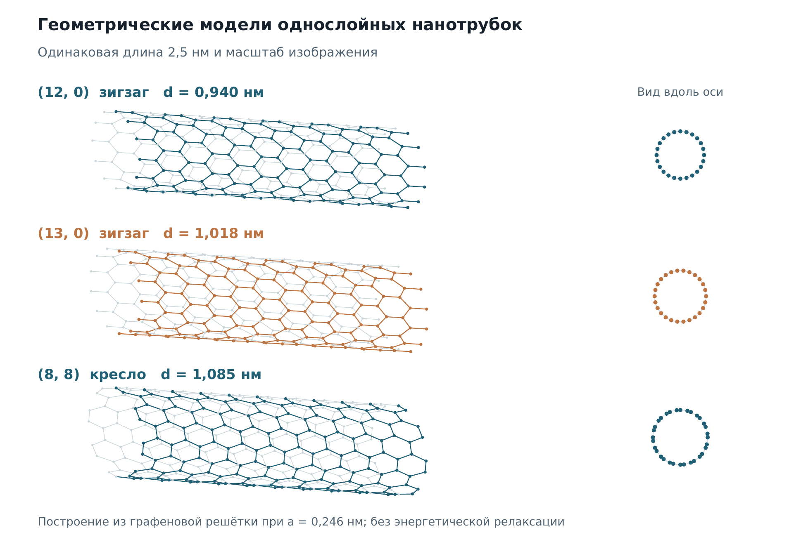
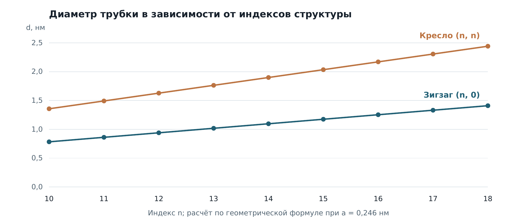
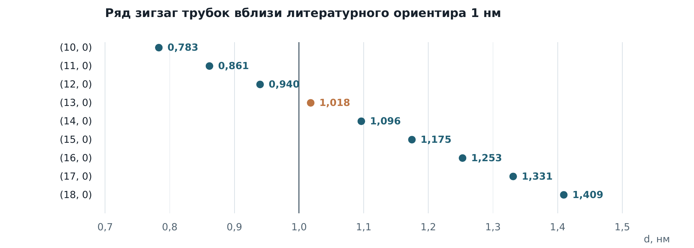

## Геометрия углеродных нанотрубок

**Воспроизводимый результат:** рассчитаны диаметры 18 структур двух семейств. Для зигзаг-трубки **(13, 0) получено 1,018 нм**; соседние варианты позволяют сформировать ряд для дальнейшего физического сравнения.



*Модели (12, 0), (13, 0) и (8, 8) одинаковой длины 2,5 нм. Геометрия построена из графеновой решётки, без энергетической релаксации.*

### Исходная задача и мой вклад
В групповом ПИР я участвовал в изучении взаимодействия нанотрубок с бензолом и постановке задачи подбора структуры. Мы рассматривали два разных вопроса: может ли молекула войти в канал и будет ли она устойчиво находиться внутри.

### Что я сделал
Я переводил физический вопрос в параметры модели: размер трубки, семейство структуры и условия сравнения. В расчётном дополнении к портфолио сравнил геометрию и выбрал соседние варианты для дальнейшего исследования.

### Воспроизводимое дополнение к портфолио
К портфолио я добавил геометрические модели и расчётный набор из 18 структур: `n = 10…18`, семейства зигзаг `(n, 0)` и кресло `(n, n)`.

`d = a / π × √(n² + nm + m²)`, где `a = 0,246 нм`.

Это диаметр по центрам атомов углерода, а не свободный внутренний просвет.



При одинаковом n диаметр кресло больше диаметра зигзаг в √3 раза. Для (12, 0), (13, 0), (14, 0) получены 0,940; 1,018; 1,096 нм.



В работе Milko и Ambrosch-Draxl (2011) структура (13, 0) получена как энергетически предпочтительная для бензола в условиях их DFT-расчёта. Литературный ориентир около 1 нм помогает выбрать ряд, но не устанавливает универсальный порог вхождения.

### Как повторить геометрический расчёт
```bash
python nanotube_geometry.py
```
Стандартная библиотека Python. Скрипт сохраняет `nanotube-diameters.csv`; исходные значения также представлены в [diameters.csv](diameters.csv).

### План физического исследования
Для следующего этапа я предложил отдельно сравнить диаметры при фиксированных длине, температуре, модели взаимодействия и ориентации бензола. Затем — менять температуру при выбранной структуре. Для анализа нужно сохранять положение молекулы, её ориентацию и энергию взаимодействия во времени.

### Границы результата
Здесь я показываю выполненный геометрический расчёт. Энергия взаимодействия, молекулярная динамика и температурные эффекты остаются следующим этапом. По одним диаметрам я не устанавливаю порог вхождения бензола. Расчётное дополнение к портфолио отделено от исходного группового ПИР.

### Источники
- Qin L.-C. (2007), определение хиральных индексов: https://doi.org/10.1039/B614121H
- Milko M., Ambrosch-Draxl C. (2011), бензол внутри нанотрубок: https://doi.org/10.1103/PhysRevB.84.085437

---

[← Все кейсы](https://github.com/antonyakovlev11)
